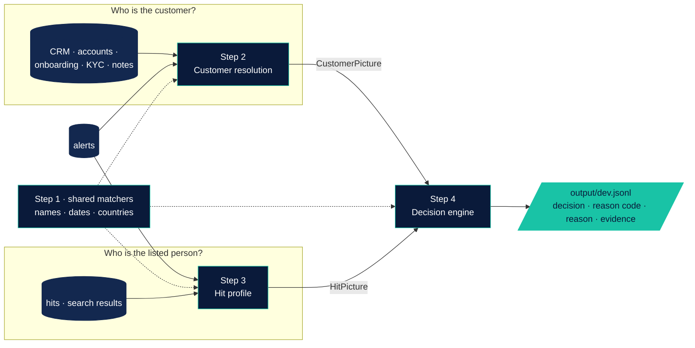

<div align="center">

<picture>
  <source media="(prefers-color-scheme: dark)" srcset="assets/brand/vera-logo-reversed.svg">
  
</picture>

### Same person or not?

**Watchlist screening that clears the obvious false positives, keeps every real or uncertain match for a human, and explains each decision with the records behind it.**


[What it does](#what-it-does) · [How it decides](#how-it-decides) · [Architecture](#architecture) · [Quick start](#quick-start) · [Vera app](#vera-the-analyst-app) · [Status](#project-status) · [Repository map](#repository-map)

</div>

---

## What it does

A bank screens every customer against sanctions lists, lists of politically exposed people (PEPs) and adverse-media records. Names are matched loosely, so most matches, called **hits**, are just namesakes. For every hit, this system answers one question: **is this listed person actually our customer?**

To answer it, the system works out two things and then compares them:

| | Who is the customer? | Who is the listed person? |
|---|---|---|
| **Where the facts live** | CRM records, accounts, onboarding, identity (KYC) checks, support notes | The watchlist profile, its free-text notes, web search results |
| **What makes it hard** | One person can have several records; family members share phones and addresses; nicknames and typos | Dates of birth hidden in prose ("aged 30 in November 1998"); search results mostly about other people with the same name |

Each hit gets one of three decisions:

| Decision | Meaning |
|---|---|
| 🟢 `DIFFERENT_ENTITY` | A fact proves it is someone else. The hit is cleared. |
| 🔴 `SAME_ENTITY` | The facts show it is the customer. The hit goes to compliance. |
| 🟡 `REVIEW` | The facts can't settle it. An analyst decides. |

> Every decision comes with a reason code, two to four sentences naming the deciding facts, and the IDs of the records that decided it. Nothing is cleared without evidence.

## How it decides

### The one rule behind every choice

| Mistake | Cost |
|---|---|
| Clearing a hit that is really the customer | **60** |
| Sending a different person to review | 3 |
| Sending a real match to review | 2 |

Wrongly clearing a sanctioned person is twenty times worse than an unneeded review. So **whenever the data is ambiguous, the system picks the reading that cannot clear a hit**. Anything that makes two people look *more alike* (an extra name match, an extra country) is safe to add. Anything that makes them look *different* must be certain.

### Clear only on a contradiction, confirm only on agreement

A hit is cleared only when a fact **contradicts** it:

| Check | Example |
|---|---|
| ⏳ **Time** | The customer was 7 when the fraud report was written |
| 🎂 **Date of birth** | The customer was born in 1988; the hit in 1952 |
| 🌍 **Location** | Every country tied to the customer differs from every country tied to the hit |
| 🔤 **Verified name** | The customer's passport name doesn't match any of the hit's names |
| 🏢 **Type** | One is a person, the other a company |
| ✝️ **Death** | The listed person died before the customer was screened |

It is confirmed only when **name and date of birth agree** (or name and country, for a company) and nothing contradicts them. **Missing information is never a mismatch**: a birth year alone can still agree with a full date.

## Architecture



- **Every fact carries its source.** A date of birth is stored with the ID of the record it came from (`KYC-…`, `NOTE-…`, `H-…`, `SR-…`), so the decision can cite exactly the records that decided it.
- **Deterministic.** Standard-library Python with fixed rules and fixed tables: the same input gives the same output on every run.
- **Fails safe.** If anything crashes on a hit, that hit goes to `REVIEW`, never to a clearance.

## Quick start

Python 3.10 or later; nothing to install.

```bash
# decide every hit in a data folder, one JSON line per hit
system/run datasets output/dev.jsonl

# run the unit tests
python -m unittest discover -s tests -t .
```

One output line looks like this:

```json
{"hit_id": "H-…", "alert_id": "A-…", "decision": "DIFFERENT_ENTITY", "reason_code": "DOB_MISMATCH",
 "customer_record_id": "CUS-…", "reason": "The customer was born in 2001 (KYC-…); the hit's search results put its birth year at 1965 or 1966 (SR-…).",
 "evidence": ["KYC-…", "SR-…"]}
```

## Vera: the analyst app


Vera is the command-line app on top of the screening system. Launch it from the repo folder:

```
vera            # Windows cmd / PowerShell (vera.cmd)
./vera          # Git Bash, macOS, Linux
vera dev/       # optional: point it at another data folder
```

To type just `vera` from anywhere, add this repo folder to your PATH.

| Menu | What it does |
|---|---|
| **Run Vera** | Decide every hit and see the summary, including the practice-label score and unsafe clearances |
| **Review queue** | Open alerts, then an alert's hits, then a hit side by side with the customer. On a hit, `t` shows the decision tree, `e` drafts emails and `d` records your own decision |
| **Decision guide** | An interactive yes/no walk through the identity SOP |
| **Draft all emails** | For every REVIEW hit, an internal draft and, where the customer can help, a neutral customer draft. Drafts are checked for tipping-off words and are never sent |

**Keys:** `↑` `↓` move · `enter` open · `esc` / `←` back · `q` quit. In terminals that can't read single keys, Vera shows numbered menus instead.

Vera never changes the graded output (`system/run`, `output/dev.jsonl`). Its files go in `.vera/` and `emails/`, both gitignored.

## Project status

The work plan with every step is in [`steps.txt`](steps.txt).

| Step | What | Status |
|---|---|---|
| 0 | Foundation: entry point, data loader, shared data model | ✅ On `main` |
| 1 | Shared matchers: names, dates, countries | ✅ On `main` · 70 tests |
| 2 | Customer resolution | 🔧 Built in [`step2/`](step2/STEP2.md) (50/50 practice labels), being wired into `system/` |
| 3 | Hit profile | ✅ On `main` · 23 tests |
| 4 | Decision engine | ⏳ Stub: every hit goes to `REVIEW` for now |
| 5 | Evaluation and QA | 🔧 A separate cautious evaluator lives in [`risk-aversion-and-intelligibility/`](risk-aversion-and-intelligibility/README.md) |
| 6 | Documentation and submission | 🔧 In progress |
| 7 | Analyst extras | ✅ The Vera app |

Until Step 4 lands, the pipeline runs end to end (819 dev hits in about 4 seconds) but sends everything to review. That scores zero, and it is never unsafe.

## Methodology

How the matchers treat names, dates and countries, and why:

- [**Step 1 methodology**](STEP1_METHODOLOGY.md): the 13 main decisions in plain language.
- [**Decision log**](DECISIONS.md): every decision with its reason and status, plus notes for later steps.

A few highlights:

- **Names in any script.** Cyrillic, Greek, Armenian, Georgian and Japanese names are transliterated with fixed tables. Names in other scripts are kept and flagged for analysts, never treated as a mismatch.
- **Generous name matching, in the safe direction.** Nicknames, typos, reordered and joined names all count as a match, because a match can only block a clearance.
- **Ambiguous dates keep every reading.** `03/04/1988` counts as a mismatch only if both 3 April and 4 March mismatch.
- **Ambiguous countries count as all of them.** `Congo` means both Congos; an extra country can only block a clearance.

## Repository map

```
system/                  the graded system
├── run                  entry point: system/run <data folder> <output file>
├── main.py              pipeline: load → resolve → profile → decide → write
├── data.py · model.py   data loader and the shared data model (Fact, pictures, Decision)
├── customer.py          step 2: who is the customer?
├── hit.py               step 3: who is the listed person?
├── decide.py            step 4: compare and decide
├── match/               step 1: names, transliteration, dates, countries
└── vera/                the analyst app
tests/                   unit tests (invented data only)
step2/                   customer resolution, before it is wired into system/
risk-aversion-and-intelligibility/   a standalone cautious evaluator and its spec
assets/brand/            Vera logo files
```

## Data and safety

- **The data stays out of the submission.** The development data comes from the event's participant data room and is for participants only. Tests use invented names and dates.
- **No secrets in the repo.** A language model, if used, is called only through OpenRouter with the key in `OPENROUTER_API_KEY`; `.env` is gitignored.
- **Drafts are never sent.** Vera's customer emails never mention screening, watchlists or sanctions (that would be tipping off).

---

<div align="center">
<sub>Built for the <b>Same Person or Not?</b> hackathon track · MIT License</sub>
</div>
